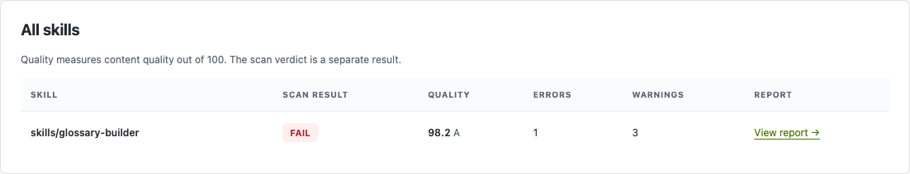

# SkillEvaluator CI 示例

这些示例位于公开的 NVIDIA/SkillEvaluator 仓库中。查看它们无需访问个人演示仓库、私有流水线或托管报告。有关设置，请[复制模板](../templates/README.md)。

## 报告预览



此捕获的示例显示一个技能得分为 **98.2/100**，而阈值为 **100 分**。由于低于配置的阈值，扫描失败。质量评分和扫描结论是分开的；安全和其他必需检查也会影响结论。此预览仅为示例，并非你仓库的结果。

GitHub 和 GitLab 将 HTML 报告保留为作业构建产物。在下载的构建产物中打开 `index.html`，然后选择一个技能查看其详细发现。

## GitHub Actions 摘要

一个简短的说明性示例：

```text
Tier 1 scan result: FAILED
1 skill · 0 passed · 1 failed
Problem: Quality score 98.2/100 is below the required 100/100
```

完整报告会指出需要关注的质量检查。改进技能以满足仓库选定的阈值，然后再次提交更改。

## 可选的 GitHub PR 评论

以下是一个简短的说明性评论，并非真实的 Pull Request：

> **github-actions[bot]**
>
> **Tier 1 scan result: FAILED**
>
> 1 skill · 0 passed · 1 failed · 0 incomplete
>
> | Skill | Status | Quality / 100 |
> | --- | --- | --- |
> | `skills/glossary-builder` | FAIL | 98.2 / A |
>
> **Problem:** Quality score 98.2/100 is below the required 100/100.
>
> **Suggested fix:** Open the skill report and address the quality findings.
>
> **Open full report** · **View workflow run**

最后一行仅显示链接标签。在实际评论中，它们链接到你仓库的托管报告和工作流运行。发布者在报告成功发布后，会更新符合条件的当前同仓库 PR 上的一条评论。请遵循[可选的发布者设置](../../docs/github-actions.mdx#enable-pr-comments)。

## GitLab 作业日志

与报告预览对应的简短摘录：

```text
Skill result: "skills/glossary-builder" — FAILED
  Quality: 98.2/100, grade "A"
  Check: "QUALITY" — "failed"
    Scanner error: "Quality score 98.2/100 is below the required 100/100 ..."
```

从作业中下载 `skill-evaluator-report` 以获取完整发现。GitLab 集成提供作业构建产物；不包含自动 MR 评论和托管报告。